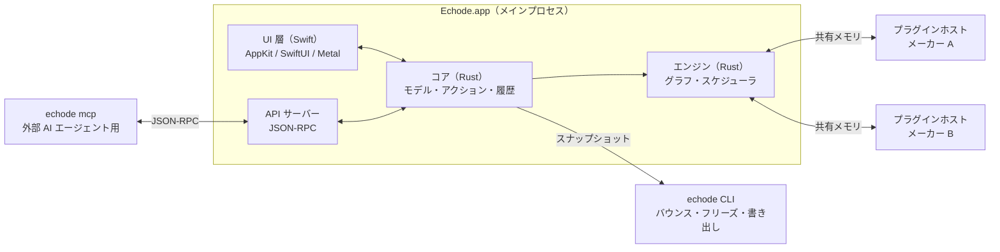

# Echode アーキテクチャ設計

- 版: ドラフト v0.1（2026-10-07）
- 計画と決定事項: [PLAN.md](PLAN.md)
- 操作要件の正本: [interaction-design.md](interaction-design.md)、[ADR 0117](decisions/0117-workflow-interactions.md)

この文書は Echode の全体構成（§1〜§3）と各ドメイン（§4〜§17）の索引・要約をまとめたものです。
領域別の詳細設計は `docs/architecture/` 配下の各ファイルを参照してください。

## ドメイン別設計書（索引）

| 領域 | 詳細設計書 | 対象節 |
|---|---|---|
| モデル・アクション・履歴 | [architecture/model-and-history.md](architecture/model-and-history.md) | §4 ドキュメントモデル、§5 アクションシステム、§6 プロジェクト形式と履歴 |
| オーディオエンジン・ルーティング・音声解析 | [architecture/audio-engine.md](architecture/audio-engine.md) | §7 オーディオエンジン、§8 ルーティング、§11 オーディオファイルと解析 |
| プラグイン隔離・スキャン・内蔵デバイス | [architecture/plugins-and-devices.md](architecture/plugins-and-devices.md) | §9 プラグインホスティング、§10 内蔵デバイス |
| UI・Metal 描画・橋渡し・ピアノロール | [architecture/ui-and-metal.md](architecture/ui-and-metal.md) | §12 GPU（Metal）、§13 UI 層、§14 MIDI とピアノロール |
| API・MCP・品質保証・ビルド配布 | [architecture/api-qa-and-distribution.md](architecture/api-qa-and-distribution.md) | §15 外部制御・API・AI、§16 品質保証、§17 ビルドと配布 |

## 1. 設計原則

対象は macOS 27 以降、M4 ファミリー以降の Apple Silicon。M1〜M3 との互換性は求めない（[ADR 0112](decisions/0112-m4-minimum.md)）。

1. **リアルタイムスレッドは何も待たない。** オーディオスレッドでは、ロック、メモリ確保、ファイル I/O、システムコールによる待機、GPU の完了待ちをしない。
2. **モデルが唯一の真実。** ドキュメントモデルは Rust 側が持ち、変更のたびに不変のスナップショットを作る。UI、エンジン、履歴、API はスナップショットを読むだけ。
3. **すべての変更はアクションを通る。** UI 操作、ショートカット、マウス、API、MCP、LLM が同じ経路を通るので、Undo、記録、再生、自動化が一貫する。
4. **外部のコードと入力を信用しない。** プラグインは別プロセスで動かす。プロジェクトファイルと API の入力は必ず検証する。
5. **時間は整数で持つ。** 浮動小数点の丸め誤差を持ち込まない。
6. **ヘッドレスで全機能が動く。** UI はクライアントの 1 つにすぎない。テスト、バウンス、AI による操作もこの上に乗る。
7. **固定の上限を作らない。** 固定長の配列やトラック数の上限を設けず、上限は CPU とメモリだけにする。UI は見えている範囲だけを描く。

## 2. プロセス構成

| プロセス | 役割 |
|---|---|
| `Echode.app` | UI、コア、エンジン、API サーバー。オーディオデバイスを開くのはこのプロセスだけ |
| `echode-plugin-host` | プラグインを読み込んで処理し、プラグインの GUI ウィンドウも持つ |
| `echode-plugin-host --scan` | プラグインのスキャン。1 つずつ時間制限付きで調べるので、途中で落ちてもスキャン全体は止まらない |
| `echode`（CLI） | ヘッドレスのコアとエンジン。バウンス、フリーズ、書き出し、プレビュー用キャッシュのレンダリング、コマンドライン操作、ヘッドレスサーバー、MCP |

## 3. モジュール構成

### 3.1 Rust（Cargo workspace）

| crate | 役割 |
|---|---|
| `echode-model` | ドキュメントモデル、時間の表現、テンポマップ、スキーマとマイグレーション |
| `echode-actions` | アクションの定義と登録簿、トランザクション、Undo、ジャーナル、マクロ |
| `echode-history` | Git との連携（`gix`）、自動コミット、セマンティック差分とマージ、メディアの保管庫 |
| `echode-engine` | グラフの組み立てと差し替え、スケジューラ、トランスポート、PDC、変調の評価、クリップの再生 |
| `echode-dsp` | 同梱 Sine Pad と確保の検出（実装済み）。EQ、ダイナミクス、変調、SRC・ストレッチのラッパーは将来の範囲 |
| `echode-media` | デコード、ストリーミング、ピークの生成、解析（テンポ、キー、トランジェント） |
| `echode-gpu` | Metal Compute のカーネル（`objc2-metal`） |
| `echode-audio-io` | CoreAudio（HAL）と CoreMIDI |
| `echode-plugin` | プラグインの共通の抽象と CLAP / VST3 / AU のアダプタ |
| `echode-sandbox` | ヘルパープロセスの起動と監視、IPC、共有メモリ |
| `echode-api` | JSON-RPC のサーバーと MCP |
| `echode-document` | 開いた文書の手番の調停（編集・再生・デバイス要求・プラグイン保存の取込み・音声の取込みの段階） |
| `echode-ffi` | Swift 向けの橋渡し |
| `echode-cli`、`echode-plugin-host` | 実行ファイル |

### 3.2 Swift

| モジュール | 役割 |
|---|---|
| `EchodeApp` | アプリのライフサイクル、ウィンドウ、メニュー、複数プロジェクトの管理（実装は `swift/EchodeApp` の `EchodeApp` と `EchodeAppCore`） |
| `EchodeBridge` | `echode-ffi` の C ABI を非同期関数と所有するスナップショットへ包む層（`swift/EchodeBridge`） |
| `EchodeCanvas` / `EchodeUI` / `EchodeInput` / `EchodeAccessibility` / `EchodeAssist` | 描画、UI 画面、入力、アクセシビリティ、自然言語コマンドの論理区分（現在は `EchodeAppCore` 内で実装） |

---

## 4. ドキュメントモデル

詳細は [architecture/model-and-history.md](architecture/model-and-history.md#4-ドキュメントモデル) を参照。

### 4.1 主なオブジェクト

`Project`、種別を持たない `Track`、`Content`（[ADR 0022](decisions/0022-clip-content-and-placement.md)）、`Placement`（[ADR 0109](decisions/0109-placement-bounds-and-plugin-capture.md)）、`Note`（[ADR 0027](decisions/0027-note-expression.md)）、`Device`（[ADR 0048](decisions/0048-clap-device.md)、[ADR 0049](decisions/0049-hosted-playback.md)）、`Parameter`、`Marker`、`Region`、`Media` で構成する。

### 4.2 不変スナップショット

アクション適用ごとに新しい版と `ChangeSet` を作り、未変更トラックは `Arc` で共有する（[ADR 0007](decisions/0007-s5-confirmed-phase1.md)）。

### 4.3 ID と並び順

UUIDv7 と親ごとの分数インデックス文字列で順序を持つ（[ADR 0024](decisions/0024-track-order.md)）。

### 4.4 時間の表現

音楽時間は `tick`（1 拍 = 705,600）、実時間は `flick`（1 秒 = 705,600,000）、エンジン内部は整数サンプル番号を使う。

### 4.5 スマートクリップ

配置は `auto` と `fixed` を持ち、窓とノートの共通部分だけを鳴らす（[ADR 0022](decisions/0022-clip-content-and-placement.md)、[ADR 0025](decisions/0025-clip-window-cuts-notes.md)）。
P2 の重ねるモードと構成編集は [interaction-design.md](interaction-design.md#アレンジの選択と編集) と [ADR 0117](decisions/0117-workflow-interactions.md) に従う。

### 4.6 パラメータと変調

`track/<id>/device/<id>/param/<id>` および `clip/<id>/device/<id>/param/<id>` の安定アドレスを使う（[ADR 0026](decisions/0026-parameters.md)）。

### 4.7 オートメーション

パラメータごとに 1 レーンを持ち、P2 のオートメーションモードと点・曲線編集は [interaction-design.md](interaction-design.md#オートメーションの表示と編集) に従う。

### 4.8 クリップ FX

Phase 2 で配置ごとの非破壊デバイスチェインと内容時刻ベースの FX オートメーションを持つ（[ADR 0059](decisions/0059-clip-fx.md)）。

## 5. アクションシステム

詳細は [architecture/model-and-history.md](architecture/model-and-history.md#5-アクションシステム) を参照。
`echode-actions` でトランザクション、Undo スナップショット、1 行 1 操作のジャーナル、TOML キーマップ、マウスコマンド、コマンドパレットを統合する（[ADR 0008](decisions/0008-actions-undo-journal.md)）。

## 6. プロジェクト形式と履歴

詳細は [architecture/model-and-history.md](architecture/model-and-history.md#6-プロジェクト形式と履歴) を参照。

### 6.1 パッケージの構成

`.echode` パッケージ内に `project.json`、`contents/`、`tracks/`、`media/`、`cache/`、`.git/` を持つ。

### 6.2 差分の取りやすい JSON

親ディレクトリ基準のリンク非追従 I/O（[ADR 0074](decisions/0074-package-entry-io.md)）とスキーマ段階移行（[ADR 0028](decisions/0028-package-schema.md)）を行う。

### 6.3 メディアの保管庫

`media/objects/` に BLAKE3-256 で不変保存し、波形ピークは `cache/peaks/` に置く（[ADR 0031](decisions/0031-content-addressed-store.md)、[ADR 0056](decisions/0056-audio-import.md)、[ADR 0058](decisions/0058-waveform-peaks.md)）。

### 6.4 保存とコミット

自動保存は `refs/echode/autosave/main` とジャーナル再生で復旧し（[ADR 0009](decisions/0009-package-autosave.md)、[ADR 0033](decisions/0033-journal-log.md)、[ADR 0057](decisions/0057-crash-recovery.md)）、`gix-pack` で間引く（[ADR 0046](decisions/0046-history-thin.md)）。
古いコミットへ後退した復旧は先端・基点・連番を通知し、編集前の明示同意と復旧状態の同期保存を要求する
（[ADR 0183](decisions/0183-recovery-consent.md)）。

### 6.5 変更内容の自動要約

2 版間の構造化差分から要約とタグを生成する。

### 6.6 履歴 UI と試聴

Phase 1 は自動保存の一覧と全体復帰（Undo 可能）を実装する（[ADR 0054](decisions/0054-history-restore.md)）。

### 6.7 オルタネイトとセマンティック・マージ

Git ブランチを並行プロジェクトとして見せ、モデル上で依存関係を含めてマージする。

## 7. オーディオエンジン

詳細は [architecture/audio-engine.md](architecture/audio-engine.md#7-オーディオエンジン) を参照。

### 7.1 スレッド

I/O スレッド、Audio Workgroup 参加ワーカー、先読みワーカー、ディスク、制御スレッドに分ける。

### 7.2 グラフ

ロックフリーキューによる実行計画差し替え（[ADR 0036](decisions/0036-audio-handoff.md)）と音声スレッドの排他所有（[ADR 0102](decisions/0102-exclusive-audio-graph.md)）を行う。
開いた出力の置換ヘルパーは文書ワーカー外で準備する（[ADR 0142](decisions/0142-background-plugin-graph-preparation.md)）。
停止中の置換で新しく要る素材は別スレッドで読む（[ADR 0147](decisions/0147-output-prewarm-and-background-media.md)）。

### 7.3 レイテンシ補正（PDC）

全ノードのレイテンシから合流点の遅延を計算し、Phase 2 のクリップ FX も経路に含める。

### 7.4 先読み処理

ライブ入力に依存しないトラックを先行処理し、操作時はリアルタイム処理へ戻す。

### 7.5 クリップの再生

制御側での素材準備・`rubato` SRC・5 ms 補間・`f64` マスター加算（[ADR 0095](decisions/0095-product-audio-buses-and-continuity.md)、[ADR 0108](decisions/0108-phase1-loop-readiness.md)、[ADR 0113](decisions/0113-product-macos-workgroup-and-caches.md)）、サンプル位置への MIDI 展開（[ADR 0035](decisions/0035-playback-plan.md)、[ADR 0037](decisions/0037-clap-events.md)）、キャッシュ後フェーダー（[ADR 0012](decisions/0012-fader-after-cache.md)、[ADR 0039](decisions/0039-bus.md)）を行う。

### 7.6 複数のセッション

開いているプロジェクトと履歴試聴用の版を独立セッションとして持ち、クロスフェードで切り替える。

### 7.7 オフラインのレンダリング

`echode` CLI でバウンス・フリーズ・ミックス書き出しを実行する（[interaction-design.md](interaction-design.md#書き出し)）。

### 7.8 プレビュー用キャッシュ

デバイス後・フェーダー前の音を区間ハッシュ鍵で `~/Library/Caches/Echode/` にキャッシュする（[ADR 0011](decisions/0011-preview-cache.md)、[ADR 0040](decisions/0040-libm.md)）。

### 7.9 出力デバイス

公開 HAL API（`objc2`）による機器管理・システム出力追従（[ADR 0015](decisions/0015-output-device-follow.md)、[ADR 0047](decisions/0047-product-audio.md)）、ループ・メトロノーム（[ADR 0055](decisions/0055-loop-metronome.md)）、準備中取消と CLAP 状態リセット（[ADR 0097](decisions/0097-cancellable-retained-transport.md)、[ADR 0099](decisions/0099-transport-plugin-state.md)）、P2 の開始位置記憶（[interaction-design.md](interaction-design.md#再生の開始位置)）を行う。
P2 のループ範囲のルーラー操作と、終端以降からの通常進行は [ADR 0156](decisions/0156-ruler-loop-range-and-entry.md) を参照する。

## 8. ルーティング

詳細は [architecture/audio-engine.md](architecture/audio-engine.md#8-ルーティング) を参照。

### 8.1 静的チャンネル（X-Y 平面）

任意のチャンネル数とバランスパンを持つ（[ADR 0039](decisions/0039-bus.md)）。

### 8.2 コンテナ（Z 軸）

並列チェインの自動加算とマクロ割り当てに対応する。

### 8.3 センド、レシーバー、サイドチェーン

循環を拒否し、P2 のセンド作成・ミュート連動・ソロ時リターン開放は [interaction-design.md](interaction-design.md#センドとレシーブ) に従う。

### 8.4 フォルダ

ネスト上限なしのフォルダバス（[ADR 0024](decisions/0024-track-order.md)）と P2 のトラック挿入・複製規則（[interaction-design.md](interaction-design.md#音源を挿して編集に入る)）を持つ。

### 8.5 フォルダ型ドラムラック（Phase 2 予定）

親フォルダに MIDI、子トラックにサンプラー（ADSR・ワンショット対応）を置くフォルダ型ドラムラック（[ADR 0116](decisions/0116-folder-drum-rack.md)）。

## 9. プラグインホスティング

詳細は [architecture/plugins-and-devices.md](architecture/plugins-and-devices.md#9-プラグインホスティング) を参照。

### 9.1 共通の抽象

CLAP（`clack-host`）、VST3、AU の共通インターフェース（AUv3 は二重ヘルパーにしない、[ADR 0111](decisions/0111-macos-helper-notices.md)）。

### 9.2 プロセスの分け方

現行製品は 1 デバイス 1 ヘルパーで動かす（[ADR 0049](decisions/0049-hosted-playback.md)）。

### 9.3 リアルタイムの通信

`posix_spawn` と共有メモリ 2 スロット（[ADR 0042](decisions/0042-plugin-ipc.md)）、一括投入と単一締め切り回収（[ADR 0043](decisions/0043-plugin-submit-collect.md)）、Mach ポートによる Audio Workgroup 受け渡し（[ADR 0111](decisions/0111-macos-helper-notices.md)、[ADR 0113](decisions/0113-product-macos-workgroup-and-caches.md)）を行う。

### 9.4 クラッシュとハング

締め切り超過時の無音化、`kqueue` と致命シグナル印による検知（[ADR 0079](decisions/0079-failed-export.md)、[ADR 0111](decisions/0111-macos-helper-notices.md)）、状態復元再起動を行う。
メインスレッド要求の所有と、時間切れ後の応答照合は [ADR 0199](decisions/0199-owned-helper-control-requests.md) を参照する。

### 9.5 GUI とデバイスビュー

ヘルパー側の GUI ウィンドウ管理（[ADR 0041](decisions/0041-helper-threads.md)）と、P2-02 の非モーダル候補パネル・`device.reorder` / `device.copy`（[ADR 0118](decisions/0118-track-fx-chain-editing.md)）。
下部は選択トラックのデバイスを横に並べ、各デバイスが画面内の行だけを作る全パラメーターの一覧・検索・ピン留めを持つ。
デバイス要求の往復は文書ワーカーの外で待つ（[ADR 0131](decisions/0131-device-view-and-responsive-parameters.md)）。
プラグイン独自のウィンドウはヘルパーの `NSPanel` が持ち、フォーカスを取らずに開く。プラグイン側の値とジェスチャーは処理スレッドのリングから親へ中継し、
ジェスチャー終了を 1 回の Undo にする（[ADR 0132](decisions/0132-helper-plugin-windows.md)）。
列の開閉は文書内の表示設定として保持し、音・保存・Undo を変えない（[ADR 0137](decisions/0137-device-disclosure.md)）。
独自ウィンドウの寿命は活動の編集時の状態と分け、デバイス列・インスペクターの名前の横へ窓アイコンで表示する（[ADR 0138](decisions/0138-plugin-window-status.md)）。
ヘッダは先頭名と残りのチェインのメニューから独自 GUI を開き、FX 追加ボタンとは入口を分ける（[ADR 0139](decisions/0139-track-header-fx-names.md)）。
初回の出力準備と一覧の応答待ちの表示は [ADR 0141](decisions/0141-device-output-preparation-status.md) で区別する。

### 9.6 スキャンとプラグインブラウザ

FSEvents 監視と `echode-plugin-host --scan` による差分スキャン（[ADR 0016](decisions/0016-plugin-scan-is-outside.md)、[ADR 0060](decisions/0060-plugin-folder-watch.md)）、P2 の候補追加とチェインドラッグ操作（[interaction-design.md](interaction-design.md#fx-候補とチェインの操作)）。

## 10. 内蔵デバイス

詳細は [architecture/plugins-and-devices.md](architecture/plugins-and-devices.md#10-内蔵デバイス) を参照。
共通 `Device` 抽象（[ADR 0038](decisions/0038-device.md)）の上に、Phase 1 の Sine Pad（`wavesynth`）とサンプラー（`dasp_interpolate`、[ADR 0018](decisions/0018-test-synth.md)）、後続 Phase の基本 FX・モジュレーター・マルチトラック EQ を載せる。

## 11. オーディオファイルと解析

詳細は [architecture/audio-engine.md](architecture/audio-engine.md#11-オーディオファイルと解析) を参照。
P2 の共通サンプルブラウザ（[interaction-design.md](interaction-design.md#共通サンプルブラウザ)）、AudioToolbox / Symphonia によるデコード・書き出し、64 サンプル基準の波形ピークピラミッドと 부분読込（[ADR 0058](decisions/0058-waveform-peaks.md)、[ADR 0110](decisions/0110-apple-silicon-draw-and-peaks.md)）を行う。

## 12. GPU（Metal）の使い方

詳細は [architecture/ui-and-metal.md](architecture/ui-and-metal.md#12-gpumetalの使い方) を参照。
リアルタイム経路では GPU と `Accelerate` を使わず、UI 描画・波形シェーダー・非 RT 解析で Metal（M4 Apple9 基準、[ADR 0112](decisions/0112-m4-minimum.md)）を使う。

## 13. UI 層

詳細は [architecture/ui-and-metal.md](architecture/ui-and-metal.md#13-ui-層) を参照。

### 13.1 画面の構成

単一 drawable でヘッダ・タイムライン・ミックス操作子を描く `ArrangePaneView`（[ADR 0050](decisions/0050-arrange-viewport.md)、[ADR 0051](decisions/0051-arrange-presentation.md)、[ADR 0107](decisions/0107-mix-controls.md)）、ペイン境界クリップ（[ADR 0098](decisions/0098-pane-render-boundaries.md)）、ワークスペース状態分離（[ADR 0053](decisions/0053-workspace-ui-foundation.md)）。

制作向けのファイル一覧と、標準ファイル URL の位置指定ドロップ・末尾追加の単一 Undo は [ADR 0145](decisions/0145-sample-browser-file-drops.md) に従う。
下部の個別開閉・固定高のデバイス・アレンジ非表示とウィンドウ設定の移行は [ADR 0146](decisions/0146-independent-editor-stack.md) に従う。

### 13.2 Metal のレンダラー

専用スレッドの `CAMetalDisplayLink` と 3 枠バッファ再利用（[ADR 0091](decisions/0091-playhead-wake.md)、[ADR 0110](decisions/0110-apple-silicon-draw-and-peaks.md)）、単一可視列（[ADR 0045](decisions/0045-visible-elements.md)）、`CanvasGeometryCache`（[ADR 0113](decisions/0113-product-macos-workgroup-and-caches.md)）。
アレンジの MIDI ノートは中身ごとの音域で縦に置き、可視列の矩形を Metal と VoiceOver 用の位置へ共用する
（[ADR 0165](decisions/0165-inspector-fx-add-and-arrange-note-pitch.md)）。
リサイズ時の左上固定・描画サイズの主スレッド所有と、指定ヘッダ幅の保持は [ADR 0144](decisions/0144-unscaled-canvas-resizing.md) に従う。

### 13.3 Rust と Swift の橋渡し

`cbindgen` の C ABI と `EchodeBridge` の非同期関数・所有スナップショットハンドル（[ADR 0044](decisions/0044-swift-bridge.md)）。

編集型の生成と段階的な橋渡しは [ADR 0202](decisions/0202-generated-swift-edit-actions.md) を参照する。
ピアノロールとトラック・デバイス・ミキサーの controller は生成型へ移行し、クリップ移動・音声取込みの辞書の置換は後続の範囲である。

時間単位と値の範囲は、値を返す製品 C ABI から `EchodeBridge.ModelLimits` へ渡す。
`Tick` が拍の入出力を整数へ変換し、座標の倍率とモデル範囲を直書きで重複させない
（[ADR 0200](decisions/0200-shared-model-units-and-limits.md)）。

### 13.4 トラックパッドとジェスチャー

軸別ピンチズーム、2 本指スクロール、`NSHapticFeedbackManager` の触覚フィードバック。

### 13.5 キーボード MIDI と疑似 MPE

QWERTY 鍵盤演奏とトラックパッド圧力・XY による疑似 MPE。

### 13.6 アクセシビリティ（ユニバーサルデザイン）

VoiceOver の可視・論理要素公開（[ADR 0045](decisions/0045-visible-elements.md)）とアクション完結操作。

### 13.7 トラックの自動色分け

OKLab の知覚色差に基づく系統別の自動色分け。

## 14. MIDI とピアノロール

詳細は [architecture/ui-and-metal.md](architecture/ui-and-metal.md#14-midi-とピアノロール) を参照。
ディグリー・鍵盤・ノートを単一 Metal フレームに描き（[ADR 0052](decisions/0052-piano-keyboard.md)）、P2 のノート入力・記憶長・移動伸縮・ベロシティ・トラックセレクター・ドラム入力は [interaction-design.md](interaction-design.md#ノートの入力) に従う。
自動／固定グリッドと共通吸着幅は [ADR 0185](decisions/0185-piano-auto-and-fixed-grid.md) を参照。
固定の三連符・付点も同じ幅と表示へ接続する（[ADR 0186](decisions/0186-piano-triplet-and-dotted-grids.md)）。
拍・4 拍の目印は吸着幅と独立して残す（[ADR 0187](decisions/0187-piano-independent-time-guides.md)）。

## 15. 外部制御・API・AI

詳細は [architecture/api-qa-and-distribution.md](architecture/api-qa-and-distribution.md#15-外部制御apiai) を参照。
Unix ドメインソケットの JSON-RPC 2.0（[ADR 0020](decisions/0020-json-rpc.md)、[ADR 0034](decisions/0034-api-transaction.md)）、CLI（`render` / `apply` / `serve` / `mcp`）、Phase 2 の MCP サーバー（[ADR 0115](decisions/0115-phase2-mcp.md)）、オンデバイス自然言語コマンドを提供する。

## 16. 品質保証

詳細は [architecture/api-qa-and-distribution.md](architecture/api-qa-and-distribution.md#16-品質保証) と [verification.md](verification.md) を参照。
単体・プロパティ・ゴールデン・隔離・UI・性能テストと、`scripts/verification.json` に基づく `make verify` で品質を保証する。

## 17. ビルドと配布

詳細は [architecture/api-qa-and-distribution.md](architecture/api-qa-and-distribution.md#17-ビルドと配布) を参照。
macOS 27 / `apple-m4` 基準（[ADR 0114](decisions/0114-m4-build-baseline.md)）、自己署名証明書 `Echode Local` と `EchodePluginHost.app` の分離署名（[ADR 0061](decisions/0061-distribution-signing.md)）、GPL-3.0-or-later に従う。
