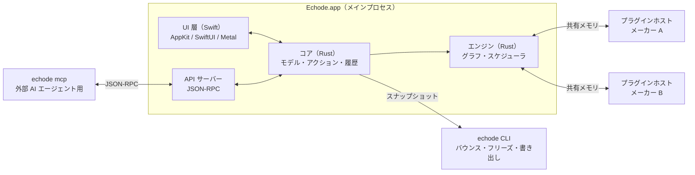

# Echode アーキテクチャ設計

- 版: ドラフト v0.1（2026-10-07）
- 計画と決定事項: [PLAN.md](PLAN.md)

この文書は「どう作るか」をまとめたものです。Phase 0 の技術検証の結果に合わせて更新し、確定した判断は `docs/decisions/` に記録します。

## 1. 設計原則

1. **リアルタイムスレッドは何も待たない。** オーディオスレッドでは、ロック、メモリ確保、ファイル I/O、システムコールを伴う待機、GPU の完了待ちをしない。
2. **モデルが唯一の真実。** ドキュメントモデルは Rust 側が持ち、変更のたびに不変のスナップショットを作る。UI、エンジン、履歴、API はスナップショットを読むだけ。
3. **すべての変更はアクションを通る。** UI の操作、ショートカット、マウス、API、MCP、LLM が同じ経路を通るので、Undo、記録、再生、自動化が一貫する。
4. **外部のコードと入力を信用しない。** プラグインは別プロセスで動かす。プロジェクトファイルと API の入力は必ず検証する。
5. **時間は整数で持つ。** 浮動小数点の丸め誤差を持ち込まない。
6. **ヘッドレスで全機能が動く。** UI はクライアントの 1 つにすぎない。テスト、バウンス、AI による操作もこの上に乗る。
7. **固定の上限を作らない。** 固定長の配列やトラック数の上限を設けず、上限は CPU とメモリだけにする。UI は見えている範囲だけを描く。

## 2. プロセス構成



| プロセス | 役割 |
|---|---|
| `Echode.app` | UI、コア、エンジン、API サーバー。オーディオデバイスを開くのはこのプロセスだけ |
| `echode-plugin-host` | プラグインを読み込んで処理し、プラグインの GUI ウィンドウも持つ。グループごとに 1 プロセス起動する |
| `echode-plugin-host --scan` | プラグインのスキャン。1 つずつ時間制限付きで調べるので、途中で落ちてもスキャン全体は止まらない |
| `echode`（CLI） | ヘッドレスのコアとエンジン。バウンス、フリーズ、書き出し、プレビュー用キャッシュのレンダリング、コマンドラインからの操作、ヘッドレスサーバー、MCP |

エンジンを UI と同じプロセスに置く理由は次のとおりです。

- Swift には GC による停止がなく、オーディオ処理は専用のリアルタイムスレッドで動くので、UI の負荷が音に影響しにくい
- メーターや波形のデータを、複製せずに UI と共有できる
- UI 層が万一落ちても、操作ジャーナルから復旧できる
- UI とコアの境界はアクションとスナップショットだけなので、必要になればエンジンを別プロセスに移せる

## 3. モジュール構成

### 3.1 Rust（Cargo workspace）

| crate | 役割 |
|---|---|
| `echode-model` | ドキュメントモデル、時間の表現、テンポマップ、スキーマとマイグレーション |
| `echode-actions` | アクションの定義と登録簿、トランザクション、Undo、ジャーナル、マクロ |
| `echode-history` | Git との連携（gix）、自動コミット、セマンティック差分とマージ、メディアの保管庫 |
| `echode-engine` | グラフの組み立てと差し替え、スケジューラ、トランスポート、PDC、変調の評価、クリップの再生 |
| `echode-dsp` | 内蔵 DSP（EQ、ダイナミクス、モジュレーター、サンプルレート変換、ストレッチのラッパー） |
| `echode-media` | デコード、ストリーミング、ピークの生成、解析（テンポ、キー、トランジェント） |
| `echode-gpu` | Metal Compute のカーネル。Rust から objc2-metal で呼ぶので、CLI でも使える |
| `echode-audio-io` | CoreAudio（HAL）と CoreMIDI |
| `echode-plugin` | プラグインの共通の抽象と、CLAP / VST3 / AU のアダプタ |
| `echode-sandbox` | ヘルパープロセスの起動と監視、IPC、共有メモリ |
| `echode-api` | JSON-RPC のサーバーと MCP |
| `echode-ffi` | Swift 向けの橋渡し |
| `echode-cli`、`echode-plugin-host` | 実行ファイル |

### 3.2 Swift

Swift のコードは役割ごとに Swift Package に分け、アプリ本体は定義ファイルから生成する Xcode プロジェクトで組み立てます。

| モジュール | 役割 |
|---|---|
| `EchodeApp` | アプリのライフサイクル、ウィンドウ、メニュー（メニュー項目もすべてアクション）、複数プロジェクトの管理 |
| `EchodeBridge` | Rust の FFI を Swift から自然に使えるように包む層 |
| `EchodeCanvas` | Metal の 2D レンダラーと、それで描く画面（アレンジ画面、ピアノロール、オーディオエディタ、オートメーション、メーター） |
| `EchodeUI` | インスペクター、ブラウザ、デバイスビュー、ミキサー、設定、履歴の画面 |
| `EchodeInput` | ジェスチャー、触覚、キーボード MIDI、疑似 MPE、キーマップとマウスコマンドの解決 |
| `EchodeAccessibility` | Metal で描いた画面のアクセシビリティ要素 |
| `EchodeAssist` | 自然言語コマンド（Foundation Models） |

## 4. ドキュメントモデル

### 4.1 主なオブジェクト

- **Project**: グローバルマーカー、リージョン、コードトラック、トラックの木、マスター、設定
- **Track**: 種別を持たない。MIDI、オーディオ、オートメーションのどのクリップも置ける。デバイスチェイン、静的チャンネル、ルーティング、子トラック（フォルダ）を持つ
- **Content（中身）**: ノート列、オーディオの参照、テイクの ID。内容時刻 0 は中身を作ったときに固定する。配置は中身の ID を持つ（[ADR 0022](decisions/0022-clip-content-and-placement.md)）
- **Placement（配置）**: トラック上の窓。開始、長さ、内容オフセット、自動か固定か、線形ゲイン、入りと出のフェード。レーンは今はタイムラインだけ。保存上の名前は clip
- **Note**: 音高、開始位置、長さ、16 ビットのベロシティとリリースベロシティ、アーティキュレーションの参照。表情の曲線（Pitch、Timbre、Pressure）はノートの行ではなく、中身の別配列にノート ID で置く（[ADR 0027](decisions/0027-note-expression.md)）
- **Device**: プラグイン、内蔵デバイス、コンテナ、モジュレーター、レシーバー。それぞれパラメータを持つ
- **Parameter**: ベース値（固定値かオートメーション）と、変調の割り当て
- **Marker**: テンポ（瞬時の変化か直線的な変化）、拍子、キー（主音と旋法）、汎用のマーカー
- **Region**: 名前付きの時間範囲。範囲内にある全トラックの内容をまとめて移動・複製できる
- **Media**: 音声ファイルへの参照（内容のハッシュ、元の名前、形式、サンプルレート、長さ）

### 4.2 不変スナップショット

モデルは不変のスナップショットで持ちます。アクションを 1 つ適用するたびに、新しい版と「何が変わったか」の一覧（ChangeSet）ができます。Phase 1 の最初の実装は、変わっていないトラックを `Arc` で共有します。ノート列まで構造を共有しないと Undo が重いと分かってから、永続データ構造（`imbl`）に替えます（[ADR 0007](decisions/0007-s5-confirmed-phase1.md)）。

- **UI**: ChangeSet を受け取り、関係する画面だけを更新する。描画スレッドは任意の版を安全に読める
- **エンジン**: ChangeSet からグラフの差分を作り、裏で組み立ててから差し替える
- **履歴**: 版を JSON に書き出してコミットする
- **Undo**: 過去の版を保持しておくだけで実現できる

### 4.3 ID と並び順

- 全オブジェクトに UUIDv7 を振り、参照はすべて ID で行う
- トラックの並び順は、同じ親の兄弟ごとに分数インデックスの文字列で持つ。アレンジ画面の順は、そのキーで木から作る（[ADR 0024](decisions/0024-track-order.md)）。デバイスの並びは、デバイスをモデルに入れるときに同じ形にする

### 4.4 時間の表現

| 種類 | 単位 | 用途 |
|---|---|---|
| 音楽上の時間 | tick（1 拍 = 705,600） | ノート、クリップ、マーカーなど、拍に乗るもの |
| 実時間 | flick（1 秒 = 705,600,000） | 時刻に固定するもの（効果音、将来の映像同期）、オーディオファイル内の位置 |
| サンプル | 整数のサンプル番号 | エンジンの内部だけで使う |

705,600 は 2⁶ × 3² × 5² × 7² なので、3・5・7 連符とその入れ子、1/256 音符まで割り切れます。flick は 44.1kHz 系と 48kHz 系の主要なサンプルレート（8kHz〜192kHz）と、一般的な映像のフレームレート（23.976fps なども含む）で割り切れます。デバイスのサンプルレートを変えても、モデルは変わりません。

テンポマップは、区間ごとの一定のテンポと直線的なテンポ変化で構成し、tick と flick を閉じた式で相互に変換します。

### 4.5 スマートクリップ

配置は `auto`（自動）と `fixed`（確定）の 2 つの状態を持ちます。ノートは中身にあり、自動配置は中身につき 1 つまでです。窓を前へ伸ばすときは開始とオフセットを同じだけ動かし、既存ノートの `start` は書き直しません（[ADR 0022](decisions/0022-clip-content-and-placement.md)）。鳴らすのは、ノートと窓の共通部分だけです（[ADR 0025](decisions/0025-clip-window-cuts-notes.md)）。

- クリップのない場所にノートを置くと、そのノートを含む 1 小節分の `auto` クリップができる
- `auto` クリップの隣の小節にノートを置くと、クリップが小節単位で伸びる。`auto` クリップは常に「中のノートを含む最小の小節範囲」に保つ（初期案）
- クリップの境界を手で編集（伸縮、分割、移動）すると `fixed` になり、以後は自動で伸び縮みしない。`fixed` クリップの隣に置いたノートは、新しい `auto` クリップになる
- `auto` クリップのノートがすべて消えたら、クリップも消える

### 4.6 パラメータと変調

最終値は、「ベース値に加算型の変調の合計を足し、範囲内に収めた値」に、乗算型の変調の積を掛けたものとします（初期案）。

- ベース値: 固定値、またはオートメーションの値
- 加算型: 双極（−1〜+1）か単極（0〜1）の変調源に、深さを掛けた量
- 乗算型: 0〜1 の値を掛ける（例: エンベロープで開閉する）
- 計算は正規化した値（0〜1）の上で行う

CLAP のプラグインには、ベース値をパラメータ値のイベントとして、変調を変調イベント（プラグイン内で非破壊に加算される）として送ります。乗算型は、その時点の加算量に換算して送ります。VST3 と AU には、最終値をサンプル位置付きのイベントとして送ります。

パラメータには `track/<id>/device/<id>/param/<id>` の形の安定したアドレスを振り、API、MCP、コントロールサーフェス、マクロから同じ形で指定できるようにします。トラックを作ると内蔵のミキサーが付き、音量、パン、ミュート、ソロはそのパラメータです（[ADR 0026](decisions/0026-parameters.md)）。

### 4.7 オートメーション

- オートメーションは、パラメータのベース値を時間で変えるもの。レーンはパラメータごとに 1 本
- **オートメーションクリップ**: レーンの上に置く独立したオブジェクト（Reaper の Automation Item に相当）。移動、複製、ループ、リンクした複製（片方を直すともう片方も変わる）ができる。クリップのない区間ではレーン自体の曲線を使う
- 点と点の間の曲線: 直線、ベジェ（張り具合を指定）、ステップ、S 字
- 書き込みモード: 読み取り、タッチ、ラッチ、書き込み
- **オートメーションモード**: 切り替えると、各トラックの行に「そのトラックで最後に触ったパラメータ」の曲線が重ねて表示され、レーンを開かずにその場で編集できる。表示するパラメータは行ごとに切り替えられる
- 通常時は、パラメータを触るとそのレーンがトラックの下に自動で開く

## 5. アクションシステム

アクションは、次の情報を持つ定義として登録します。

- ID（例: `clip.split`、`transport.play`、`pane.toggle_left`）
- 表示名と説明（日本語と英語。コマンドパレットと LLM が使う）
- 引数のスキーマ（JSON Schema）
- 実行できる条件（フォーカス中の画面、選択中のもの）
- 既定のショートカット、Undo の扱い

モデルを変えるアクションは Rust 側に実装するので、ヘッドレスでも動きます。ペインの開閉やズームのような UI だけのアクションは Swift 側に実装し、同じ登録簿に載せます。これで、コマンドパレット、キーマップ、API、LLM から、すべてのアクションを同じ方法で呼べます。

- **トランザクション**: 複数のアクションを 1 つの Undo 単位にまとめる。ドラッグ中の連続した変更も 1 回の Undo で戻る
- **ジャーナル**: 確定したアクションを順に追記していくファイル。クラッシュしたら、最後の自動コミットにジャーナルを再生して復旧する
- **マクロ**: アクション列の記録と再生
- **キーマップ**: フォーカス中の画面（アレンジ画面、ピアノロール、デバイスビューなど）ごとに割り当てを持つ。初期値は Live を基準にし、TOML ファイルで編集できる
- **マウスコマンド**: 「対象（ノートの端、クリップの本体など）× 修飾キー × 操作（クリック、ドラッグ、ダブルクリック）」からアクションへの対応表。ツールを切り替えずに、修飾キーと文脈だけで編集できるようにする
- **コマンドパレット**（Cmd+Shift+P）: 全アクションをあいまい検索（`nucleo`）し、使う頻度で並べ替える。引数が必要なアクションは、その場で入力を求める

最初の実装は `echode-actions` です。Undo は操作前のスナップショットを積むだけで、変わっていないトラックは `Arc` のまま共有します。ジャーナルには、その時に採番した ID を含めた操作を 1 行ずつ残します。Undo した操作はジャーナルの先端から外すので、クラッシュ後に再生して戻るのは今の状態です。ドラッグのような連続した操作は 1 つの Undo 単位にまとめ、途中で失敗したらその単位ごと戻します（[ADR 0008](decisions/0008-actions-undo-journal.md)）。

## 6. プロジェクト形式と履歴

### 6.1 パッケージの構成

プロジェクトは、Finder では 1 つのファイルに見えるパッケージ（フォルダ）です。

```text
MySong.echode/
  project.json          プロジェクト全体（マーカー、リージョン、中身の ID、トラックの並び、マスター）
  contents/<id>.json    中身ごとに 1 ファイル（ノート、オーディオの参照、テイク）
  tracks/<id>.json      トラックごとに 1 ファイル（デバイス、状態のハッシュ、配置）
  media/index.json      メディアの一覧（ハッシュ → 元の名前、形式、長さ）
  media/objects/...     音声とプラグインの状態（BLAKE3 で命名し、書き換えない）。Git の外で管理する
  cache/                波形のピーク、解析結果、ストレッチのキャッシュ（再生成できるので履歴に入れない）
  .git/                 履歴（ユーザーには見せない）
```

### 6.2 差分の取りやすい JSON

- キーの順序を固定し、時間は整数で書き、小数は最短で元の値に戻せる表記に統一する。同じ状態からは常に同じファイルができる
- ノートは 1 つにつき 1 行で書く。1 ノートの編集が 1 行の差分になる
- 参照はすべて ID で行う。スキーマのバージョンとマイグレーションを持つ。古い版は 1 段ずつ今の版へ上げてから読む（[ADR 0028](decisions/0028-package-schema.md)）
- 外部で編集された場合（上級者や AI エージェントが JSON を直接書き換えた場合）はそれを検出し、検証してから新しい版として取り込む

### 6.3 メディアの保管庫

音声ファイルとプラグインの状態は、BLAKE3-256 の小文字 16 進で名前を付けて `media/objects/` に置き、一度置いたら書き換えません。トラックの JSON は、デバイスの `state` でそのハッシュを参照します。今のミキサーは `null` です（[ADR 0031](decisions/0031-content-addressed-store.md)）。Git には `media/index.json` の参照だけが入るので、リポジトリは小さいままです。どの版からも参照されなくなったファイルだけを掃除の対象にするので、過去の版に戻ってもファイルが欠けることはありません。「収集して保存」は、プロジェクトの外にあるファイルをこの保管庫にコピーします。

### 6.4 保存とコミット

| きっかけ | コミット先 | 履歴 UI での扱い |
|---|---|---|
| 自動保存（一定時間操作がない時か、一定量の変更があった時） | 隠し参照 `refs/echode/autosave/<オルタネイト>` | 細かい点として表示する |
| Cmd+S | オルタネイトのブランチ `refs/heads/<オルタネイト>` | 名前付きの保存ポイントとして表示する |

- コミットは裏のスレッドで行い、変更のあったファイルだけを書く。製品のパッケージはスキーマ 1 の JSON で、自動保存は `refs/echode/autosave/main` に置く。ジャーナルは、それが基点にしているコミットが最新のときだけ再生する（[ADR 0009](decisions/0009-package-autosave.md)）
- 自動保存の履歴は Time Machine のように間引く（直近 24 時間は全部、1 か月までは 1 時間ごと、それより前は 1 日ごと。初期値は要調整）。Cmd+S の保存ポイントは間引かない
- 定期バックアップ: 履歴を `git bundle` にまとめ、メディアはハッシュを比べて差分だけを別の場所へコピーする。パッケージごと失っても履歴は残る

### 6.5 変更内容の自動要約

2 つの版のモデルを比べて構造化した差分（トラックの追加、デバイスの追加、パラメータの変更、ノートの編集数、テンポの変更など）を作り、規則に従って要約とタグを付けます。

- 要約の例: 「Vocal にリバーブを追加」「テンポ 120 → 128」「Bass のノートを 12 個編集」
- タグの例: アレンジ、ミックス、音作り、テンポと構成
- 要約をより自然な文章にするためにオンデバイスの LLM を使うこともできるが、必須にはしない

### 6.6 履歴 UI と試聴

- 版を時間軸に並べ、アレンジ画面の縮小画像、要約、タグを表示する。時間軸は拡大縮小でき、保存ポイントだけに絞り込める
- 試聴の方式は、次の 2 つを比べて Phase 4 で決める
  - **差分の適用**: 再生中のセッションに過去の版との差分を一時的に当て、戻す時は逆の差分を当てる。近い版なら速い
  - **別のセッション**: 過去の版を 2 つ目のセッションとして読み込み、A/B を即座に切り替える。遠い版でも正確だが、読み込みに時間とメモリがかかる
- 復帰は履歴を書き換えず、「過去の状態に戻した」という新しい版として記録する。選んだトラックだけを戻すこともできる

### 6.7 オルタネイトとセマンティック・マージ

- オルタネイトの実体は Git のブランチ。ユーザーには「並行プロジェクト」として見せる
- マージには Git のテキストマージを使わず、モデルの上で行う。取り込むトラックを選ぶと、依存するもの（センド先、レシーバーの参照元、サイドチェーン、メディア、プラグインの状態）を洗い出し、一緒に持ってくるかを確認する
- 同じ ID のオブジェクトがすでにある場合は、「置き換える」か「両方残す（新しい ID を振る）」を選べる
- 取り込みは 1 つのアクション（Undo できる）として実行し、出どころを残すために両方の版を親に持つコミットにする
- 別のプロジェクトからトラックを D&D で取り込む時も、同じ仕組みを使う

## 7. オーディオエンジン

### 7.1 スレッド

| スレッド | 優先度 | 役割 |
|---|---|---|
| I/O スレッド | リアルタイム（CoreAudio が用意する） | 1 ブロックの処理を始め、自分も処理に加わる |
| ワーカー（Workgroup の推奨本数から IO スレッドを引く） | リアルタイム。時間制約を付けてからデバイスの Audio Workgroup に参加する | グラフのノードを並列に処理する |
| 先読みワーカー | 高 | 先読みの対象のトラックを、数百 ms 先まで処理する |
| ディスク | 通常 | 音声ファイルの先読み |
| 制御 | 通常 | グラフの組み立て、プラグインの状態の取得、不要になったメモリの解放 |

ワーカーを Audio Workgroup に参加させると、OS はこれらのスレッドを同じ締め切りを持つ仕事として扱い、コアの選び方やクロックを適切に調整します。

### 7.2 グラフ

- ChangeSet をもとに、制御スレッドで新しい実行計画（ノードの依存関係、バッファの割り当て、レイテンシ補正のための遅延量）を組み立て、ロックなしでオーディオスレッドに渡して差し替える。再生計画は計画用とパラメータ用の別々のキューで渡し、古い計画は制御スレッドが解放する（[ADR 0036](decisions/0036-audio-handoff.md)）
- 古い実行計画の解放は制御スレッドで行う
- プラグインのインスタンスは実行計画をまたいで生き続けるので、グラフを差し替えても音は途切れない
- トラックのノードは、デバイスを処理する代わりに、プレビュー用キャッシュ（§7.8）の音を読む形に差し替えられる。キャッシュの本体は Phase 3 だが、ノードは Phase 1 からこの形で作る
- スケジューラはノードごとの依存カウンタで動き、準備のできたノードをオーディオスレッドとワーカーが取る。待ちは、残りのノードがどれも実行中のときだけにする（[ADR 0003](decisions/0003-audio-thread-does-not-wait.md)）

### 7.3 レイテンシ補正（PDC）

全ノードのレイテンシから経路ごとの遅れを計算し、合流点（トラックの加算、コンテナの出口、センド、レシーバー、マスター）に遅延を入れてそろえます。プラグインがレイテンシを変えた時は、グラフを組み直して切り替えます。録音中のモニタリング用に、レイテンシの大きいプラグインを一時的に迂回する低レイテンシモードを用意します。

### 7.4 先読み処理

ライブ入力に関係しないトラック（録音待機中やモニタリング中ではなく、そうしたトラックに依存もしていないトラック）は、再生位置より数百 ms 先まで先行して処理し、リングバッファから出力します。CPU 負荷の波を吸収できるので、小さいバッファでも音切れしにくくなります。先読み中のトラックのつまみを触った時や、プラグインの GUI を開いた時は、反応の遅れを避けるために自動でリアルタイムの処理に戻します。

### 7.5 クリップの再生

- **オーディオ**: ディスクスレッドがクリップごとの先読みバッファを満たし、オーディオスレッドはバッファから読むだけにする。データが間に合わない時は、そのクリップだけを無音にして記録を残し、決して待たない
- **サンプルレートとビット深度の混在**: ファイルは元のサンプルレートのまま 32bit 浮動小数点にデコードし、デバイスとレートが違うクリップにだけ、サンプルレート変換をリアルタイムにかける。同じレートのクリップは変換を通さずそのまま読む。変換は既存のライブラリから選べるようにし、再生用と書き出し用で別々に設定できる。既定は rubato で、比率が一定のクリップは FFT 方式、比率が変わるクリップ（バリスピードなど）は sinc 方式を使う。r8brain-free-src、soxr、zita-resampler、libsamplerate、macOS の AudioConverter は、同じ方法で測り、ほかに完全に劣るのでなければ選択肢に加える（[ADR 0014](decisions/0014-existing-implementations-as-options.md)）。プレビュー用キャッシュとフリーズは再生用の設定で作る。変換はタイムストレッチやバリスピードと 1 段でまとめて処理する
- **変換の状態**: ライブラリの変換は内部に状態を持ち、出力が入力より少し遅れる。シークやループの頭では、その位置より前から処理して状態を作り、遅れを取り除いて、出力のサンプル 0 が入力のサンプル 0 に合うようにする。比率が一定のクリップは、クリップの頭から数えた処理単位の区切りから処理を始め、どこから再生しても同じ時刻には同じサンプルが出るようにする（§7.8 の一致の確認で確かめる）。rubato の sinc 方式は位置を足し算で進めるので、シークした所からの音は、頭から通した音と丸め誤差の範囲で食い違う
- **MIDI**: ノートを、制御スレッドが一度サンプル位置に落とす。オーディオスレッドはその列のカーソルを進めるだけで、モデルは読まない（[ADR 0035](decisions/0035-playback-plan.md)）。ブロックのイベントは CLAP の形で、ノート番号は再生のあいだ固定する（[ADR 0037](decisions/0037-clap-events.md)）。ループをまたぐときは、境界でまだ鳴っているノートを止めてから先頭のノートを打つ（[ADR 0010](decisions/0010-playback-samples.md)）
- **ループの継ぎ目**: ディスクスレッドは、ループの終わりが近づいたら、ループの頭のデータを先に読んでおく。オーディオクリップは継ぎ目の前後に 5 ms のフェードをかけ、波形の段差によるノイズを出さない。プラグインの状態はそのまま引き継ぐので、終わりの余韻は頭に重なって鳴る。トラックのノードは、このライブ処理の代わりにプレビュー用キャッシュを読む形へ差し替えられる（[ADR 0011](decisions/0011-preview-cache.md)）
- **フェーダー**: キャッシュの後ろに置く。モノのパンは等電力で、中央はモノのときと同じ電力を左右に分ける。ステレオのパンはバランスで、中央は左右をそのまま通す（[ADR 0039](decisions/0039-bus.md)）。ソロが 1 本でもあればそのトラックだけが鳴り、ミュートはソロより優先する。ピークはフェーダーとパンの後のチャンネルのうち大きい方（[ADR 0012](decisions/0012-fader-after-cache.md)）

### 7.9 出力デバイス

既定では、システムの出力デバイスに追従する。ヘッドフォンを挿したり抜いたりすると、システムの既定が変わった通知を受けて、再生の出力を切り替える。利用者が特定のデバイスを選んだあいだは、そのデバイスが生きている限り既定の変化を無視する。選んだデバイスが抜けたらシステムの出力に落ち、戻ったらそのデバイスに戻す。使っているデバイスのサンプルレートやバッファサイズが変わったら、再生側をその値に合わせる。どのデバイスを開くかは制御スレッドが決め、オーディオスレッドはその判断をしない（[ADR 0015](decisions/0015-output-device-follow.md)）。

### 7.6 複数のセッション

開いているプロジェクトと、履歴の試聴用に読み込んだ版は、それぞれ独立したセッション（モデル、グラフ、プラグイン）として持ちます。オーディオデバイスに出力するのは前面のセッションだけで、切り替えは短いクロスフェードで行います。背面のセッションのプラグインは読み込んだまま止めておき、メモリが足りなくなったら解放します。

### 7.7 オフラインのレンダリング

バウンス、フリーズ、書き出しは、対象の版のスナップショットを `echode` CLI のプロセスに渡して実行します。CLI は自分専用のプラグインのインスタンスを使い、リアルタイムより速く処理して進み具合を報告します。終わったら、結果をアクションとしてプロジェクトに取り込みます。その間も、メインのアプリでは編集と再生を続けられます。オフライン化は、プラグインのインスタンスを状態だけ残して解放し、グラフから外す操作です。

### 7.8 プレビュー用キャッシュ

動画編集ソフトのバックグラウンドレンダリングと同じ考え方で、編集が止まって数秒たったら、トラックの音を裏でレンダリングしておき、再生ではそれを鳴らします。プラグインの処理が減るので再生が軽くなり、途中からの再生やループの継ぎ目も、通して再生した時と同じようにつながります。本体は Phase 3 で作ります。

- **単位**: トラックごとに、デバイスを通った後・フェーダーの前の音をキャッシュする。音量、パン、ミュート、センドの量を変えても、キャッシュは無効にならない
- **鍵**: 音を一定の長さの区間に分け、その区間の音を決める入力のハッシュを、区間ごとの鍵にする。入力は、区間とその前の余韻の長さぶんのノートとオートメーション、デバイスの設定と状態、テンポマップ、サンプルレート、選択肢から選んだ実装（サンプルレート変換など）とその版、依存するトラック（サイドチェーンやレシーバーの参照元）の鍵である。OS の数学ライブラリで係数やサンプルを作る実装（rubato の sinc など）では、`sw_vers` のプロダクト版も鍵に含める（[ADR 0040](decisions/0040-libm.md)）。余韻の長さはプラグインが報告するテールから決め、無限を報告するものには上限を設ける。編集で無効になるのは、編集した時刻から余韻が消えるまでの区間だけ
- **レンダリング**: §7.7 と同じく `echode` CLI のプロセスが、自分専用のプラグインのインスタンスを使い、優先度を下げて行う。ループの範囲、再生位置の近く、残りの順に埋め、録音中は止める。メモリを抑えるため、1 トラックずつ読み込んで処理し、終わったら解放する
- **ループ**: ループの範囲は、前からの続きとしての 1 周目と、その状態を引き継いだ 2 周目を続けてレンダリングし、2 周目以降はそれを繰り返す。継ぎ目では終わりの余韻が頭に重なってつながり、ループの頭でノートが一斉に鳴っても負荷が跳ねない
- **ライブとの切り替え**: 録音待機中やモニタリング中のトラックとそれに依存するトラック、つまみを触っているトラック、プラグインの GUI を開いているトラック、キャッシュがまだない区間は、ライブで処理する（§7.4 と同じ線引き）。キャッシュからライブに移る時は、プラグインに少し前から先に処理させて状態を作り、短いクロスフェードでつなぐ。トラックを選んだ時点で、この準備を始める
- **置き場所**: `~/Library/Caches/Echode/` に鍵の名前で置く。パッケージにも履歴にも入れず、Time Machine の対象にもならない。同じ鍵の区間は、過去の版、オルタネイト、別のプロジェクトでもそのまま使えるので、履歴の試聴（§6.6）でも読み込みと処理が減る。容量の上限は設定で変えられ、使われていないものから消す
- **フリーズ**: キャッシュを消されないように固定し、プラグインを解放した状態をフリーズとする（§7.7 のオフライン化と組み合わせる）
- **毎回音が変わるプラグイン**: ランダムな要素を持つプラグインは、キャッシュにある 1 回分の音で固定される（フリーズと同じ）
- **確かめること**: ライブとキャッシュの音が一致すること（内蔵デバイスだけならビット単位。ただし rubato の sinc 方式で変換するクリップは丸め誤差の範囲、§7.5）と、切り替えの継ぎ目でノイズが出ないことを、ゴールデンテストと同じ方法で確かめる

## 8. ルーティング

### 8.1 静的チャンネル（X-Y 平面）

各トラックは任意の数のチャンネルを持ちます（既定はステレオ）。バスはスピーカーの並びと、同じ数の平面です。数に上限はありません。ステレオのパンはバランスです（[ADR 0039](decisions/0039-bus.md)）。デバイスの入出力ピンとトラックのチャンネルの対応は、表で指定できます（Reaper 方式）。チャンネルにはスピーカー配置の情報も持たせて、将来のサラウンド対応に備えます。

### 8.2 コンテナ（Z 軸）

デバイスチェインの中に、並列のチェインを持つコンテナを置けます（Live の Rack、Bitwig の Layer に相当）。各チェインの出力は出口で自動的に加算され、元のチャンネルに戻ります。コンテナは入れ子にでき、それぞれがマクロのフロントパネルを持ちます。1 つのマクロを、内部の複数のパラメータに範囲と曲線を付けて割り当てられます。周波数帯域、Mid / Side、音域、ベロシティで信号を分けるコンテナは後から追加します。

### 8.3 センド、レシーバー、サイドチェーン

- **センド**: トラックの任意の位置から、別のトラックへ信号を送る
- **オーディオレシーバー**: 受け取る側に置くデバイス。別のトラックやコンテナの中の、任意のデバイスの直後から信号を引き込む
- **サイドチェーン**: レシーバーやセンドの出力を、プラグインのサイドチェーン入力のピンにつなぐ
- **循環**: グラフを組み立てる時に検出して拒否する。意図的なフィードバックは、「1 ブロック遅れ」を明示したレシーバーでだけ許す

### 8.4 フォルダ

フォルダトラックは、子トラックの出力を受けるバスを兼ねます（Reaper 方式）。ネストの深さに上限はありません。親はトラックの ID で持ち、子は親の直後、そのフォルダに既にある子孫のうしろへ入ります。親を変えたトラックは、移動先の末尾の兄弟になります（[ADR 0024](decisions/0024-track-order.md)）。子の音をフォルダへ足すバス処理は Phase 2 です。

## 9. プラグインホスティング

### 9.1 共通の抽象

CLAP、VST3、AU の違いを 1 つのインターフェースにまとめます。中身は、サンプル位置付きのイベントによる処理、パラメータ（範囲、表示用の文字列、フラグ）、ノートの表情、状態の保存と復元、レイテンシとテール、GUI、プリセットです。

| 形式 | 実装 | 補足 |
|---|---|---|
| CLAP | `clack-host` | 主な形式。リモートコントロール、パラメータの表示状態、ノート名、ボイス情報、プリセットの探索、スレッドプール、ポリフォニック変調などの拡張にも対応する |
| VST3 | `vst3` crate | ノートの表情（Note Expression）と、サンプル位置付きのパラメータ変更に対応する |
| AU | AudioToolbox / AVFAudio | AUv3 と AUv2 を、どちらも AUAudioUnit の API で扱う |

### 9.2 プロセスの分け方

| モード | 内容 |
|---|---|
| メーカー単位（既定） | 同じメーカーのプラグインを 1 プロセスにまとめる。メーカー内のプラグイン同士の連携が動き、共通ライブラリのメモリも共有できる |
| プラグイン単位 | 同じプラグインのインスタンスを 1 プロセスにまとめる |
| インスタンス単位 | 1 インスタンスに 1 プロセス。不安定なプラグイン向け |
| 共有 | すべてのプラグインを 1 プロセスにまとめる。メモリが最も少ない |

プラグインごとにモードを上書きできます。

### 9.3 リアルタイムの通信

- オーディオバッファとイベント列は共有メモリに置き、1 ブロックごとに「処理を依頼して、完了の通知を受ける」往復をする。共有メモリは `shm_open` で作り、名前はすぐ消してファイル記述子を渡す。ヘルパーは `posix_spawn` で起動し、多スレッドの本体から `fork` しない。ブロックは 2 スロットで、入力イベントと出力イベントは分け、バイト列は検証してから読む。チャンネル数の変更、状態、`mark_dirty`、再起動の通知、`request_process` はソケットで運ぶ（[ADR 0042](decisions/0042-plugin-ipc.md)）
- 待機と通知は、プロセス間で使える軽量な仕組み（`os_sync_wait_on_address` の共有モード、または Mach セマフォ）を Phase 0 で測って選ぶ
- ヘルパー側のリアルタイムスレッドも、デバイスの Audio Workgroup に参加させる。ヘルパーが `bootstrap_check_in` した名前を親が `bootstrap_look_up` し、`os_workgroup_copy_port` の送信権を Mach メッセージで渡す。ヘルパーは `os_workgroup_create_with_port` で作り、デバイス周期の時間制約を付けてから参加する。`posix_spawn` の特別ポートでは、この送信権は届かなかった（[S3](spikes/S3-plugin-isolation.md)）
- 同じヘルパーで続けて動くデバイスは、まとめて 1 往復で処理する
- サンプル位置付きのイベントをそのまま共有メモリに書くので、隔離してもサンプル精度の変調は失われない。サンプル精度に対応しないプラグインには、ブロックを細かく分けて渡す

### 9.4 クラッシュとハング

- 締め切り（ブロックの長さに余裕を持たせた時間）までに応答がなければ、そのブロックは対象のデバイスだけを無音（短いフェード付き）にして先へ進む。遅れが続くプラグインには警告を出す
- ヘルパーの終了をカーネルのイベント（kqueue）で検知したら、影響を受けたデバイスを無音にし、デバイスビューに表示して再起動を提案する
- 再起動では、ヘルパーを起動し直してプラグインを作り直し、最後に取得した状態を復元する。状態は、プラグインが変更を通知した時（CLAP の `mark_dirty`、VST3 の `setDirty`）と定期的に、リアルタイムでないスレッドで取得しておく
- ヘルパーのメインスレッドも監視し、GUI が固まった時は利用者に確認したうえで終了できるようにする

### 9.5 GUI とデバイスビュー

プラグインの GUI は、ヘルパープロセスが持つウィンドウに表示します（Echode から見るとフローティングウィンドウです）。Echode が前面にある時だけ前に出し、Echode が背面に回ったら隠します。下部のデバイスビューには、パラメータ、CLAP のリモートコントロール、マクロ、変調の割り当てを Echode がネイティブに描画します。

ヘルパーはメインスレッドで run loop を回し、処理は別のスレッドがデバイスの Workgroup に入って行う。再起動の順番は、そのどちらでもない制御スレッドが進める（[ADR 0041](decisions/0041-helper-threads.md)）。

### 9.6 スキャンとプラグインブラウザ

プラグインの追加、更新、削除はバックグラウンドで検知し、一覧とブラウザにその場で反映します。Bitwig と同じく、Echode の再起動や手動の再スキャンは要りません。

- **検知**: CLAP と VST3 は、標準のフォルダ（`/Library/Audio/Plug-Ins/` と `~/Library/Audio/Plug-Ins/` の下の `CLAP` と `VST3`）を FSEvents で監視する。一覧は、そのフォルダと `CLAP_PATH` のディレクトリをサブフォルダまで探す。バンドルの中には入らない。変更が 2 秒止まってから、変わったバンドルだけを調べる。本体のプロセスはバンドルを読み込まない（[ADR 0016](decisions/0016-plugin-scan-is-outside.md)）。AU は、OS が出す登録の変更通知（`kAudioComponentRegistrationsChangedNotification`）を受けて一覧を取り直す。AU で通知だけで足りるかは Phase 2 で確かめる
- **スキャン**: インストーラーが書き終わるのを待ってから（変更が 2 秒止まってから）、変わったバンドルだけを `echode-plugin-host --scan` で調べる。ヘルパーは CLAP のファクトリー記述子だけを読み、インスタンスは作らない。一覧に必要な情報は、多くの場合これでそろう（VST3 は同梱の `moduleinfo.json`、AU は登録情報）。優先度の低い処理として動かし、再生と操作を妨げない
- **キャッシュ**: 結果はバンドルのパス、`Contents/Info.plist` の CFBundleVersion、実行ファイルの更新日時とサイズをキーにしてキャッシュし、アプリと CLI で共有する。起動時も全体は調べ直さず、変わったものだけを調べる。監視はコア（Rust）が行うので、ヘッドレスのサーバーでも同じように動く
- **ブラウザ**: 開いているブラウザにもその場で反映し、新しく見つかったプラグインには「新着」の印を付ける
- **更新と削除**: プロジェクトはプラグインを、パスではなく ID（CLAP の ID、VST3 のクラス ID、AU の種類・サブタイプ・メーカー）で参照する。使用中のインスタンスは更新後も古い版のまま動き続け、§9.4 の再起動と同じ手順で、状態を保ったまま新しい版に切り替えられる。削除されたプラグインのデバイスは、状態を残したまま「見つからない」と表示し、入れ直されたら自動で元に戻す
- **失敗したプラグイン**: スキャン中に落ちたり、時間内に応答しなかったりしたプラグインは除外リストに入れる。ファイルが更新されたら、自動でもう一度調べる
- **テスト**: 一時フォルダを監視対象にしてテスト用プラグインを置き、一覧に現れること、消すと一覧から消えることを確かめる
- Intel 専用のバイナリは「非対応」として一覧に出す
- プラグインブラウザはフローティングのパネルで、あいまい検索と画像のサムネイルを持つ。ダブルクリックで追加した時だけ自動で閉じ、ドラッグや Enter で追加した時は開いたままにする。それ以外では自動で閉じず、手動で閉じる
- サムネイルは、GUI を開いた時の自動キャプチャか、利用者が設定した画像を使う（自動キャプチャの方式は Phase 2 で検証する）

## 10. 内蔵デバイス

内蔵デバイスは CLAP と同じ考え方のインターフェース（パラメータ、イベント、状態、レイテンシ、余韻）で作り、プラグインと同じように扱えるようにします。テスト用シンセとサンプラーがそのインターフェースを実装します（[ADR 0038](decisions/0038-device.md)）。自前のコードなので、本体のプロセスで動かします。

- **基本セット**（Phase 2）: ユーティリティ（ゲイン、パン、ステレオ幅、位相、チャンネルの入れ替え）、EQ、コンプレッサー、リミッター、ゲート、メーター（ピーク、LUFS、トゥルーピーク、位相相関、スペクトラム）
- **テスト用の簡易シンセとサンプラー**（Phase 1）: 外部のプラグインがなくても動作の確認とゴールデンテストができるようにする。シンセの既定は wavesynth 0.1.0 の Sine Pad、サンプラーの既定は dasp_interpolate 0.11.0 の線形補間で、フロアと sinc も選べる。実装の ID と版を記録する。自作の余弦と自作の補間は選択肢にしない（[ADR 0018](decisions/0018-test-synth.md)）。本体のプロセスで動かし、呼び出し側のバッファに足す。同時に鳴らせる数に製品としての上限は置かない
- **モジュレーター**（Phase 3）: LFO、エンベロープフォロワー（任意のトラックやレシーバーを入力にできる）、ADSR、ランダム、数式。数式は安全な小さい式言語で書き、ブロックごとに評価する
- **コンテナとレシーバー**（Phase 3）: §8 を参照
- **マルチトラック EQ**（Phase 4）: 各トラックのスペクトラムをエンジンの解析用の経路で共有し、EQ の画面に他のトラックのスペクトラムを重ねて表示する。指定した 2 つのトラックで帯域がぶつかっている箇所を強調する。内蔵デバイス同士なので、別のトラックにある EQ の一覧表示や連動も簡単に作れる

## 11. オーディオファイルと解析

- **デコード**: AudioToolbox（WAV、AIFF、CAF、MP3、AAC、ALAC、FLAC など）と Symphonia（Ogg Vorbis など）を組み合わせる。RF64、W64、BWF のメタデータ（タイムスタンプ、キューポイント、ループ情報、テンポ情報）は独自のパーサーで読む
- **書き出し**: WAV、AIFF、CAF、FLAC、ALAC、AAC。エンコーダーは AudioToolbox を基本にし、足りない形式は GPL と両立するライセンスのライブラリで補う。MP3 は後回し
- **解析**（GPU でまとめて処理する）: 波形ピークの多段解像度のデータ、スペクトログラム、トランジェントの検出、テンポの推定とビートの追跡、キーの推定、ラウドネス。結果はキャッシュし、同じファイルを解析し直さない
- **タイムストレッチとピッチ**:
  - Signalsmith Stretch（MIT）: 和音を含む素材向けの高品質なモード
  - Bungee（MPL-2.0）: 遅延の小さい、リアルタイム向けのモード
  - Rubber Band（GPL-2.0-or-later）: Phase 4 の前に上の 2 つと比べ、どちらかに完全に劣るのでなければ選択肢に加える（PLAN §2.1）
  - リピッチ（バリスピード）は、サンプルレート変換（§7.5）の比率を変えて行う
  - ビート（トランジェント単位のスライス）は、Echode の解析結果とクリップの再生に密に結びつくので独自に作る
  - トランジェントごとのピッチ編集は、スライスした区間ごとにピッチを変え、クロスフェードでつなぐ。重い処理は裏で事前にレンダリングしてキャッシュする
- **オーディオエディタ**: ワープマーカーの精密な調整、トランジェントへの吸着、スライス、区間ごとのピッチとゲインを、すべて非破壊で編集する

## 12. GPU（Metal）の使い方

| 用途 | 処理する場所 | リアルタイムの経路に入るか |
|---|---|---|
| UI の描画 | Swift のレンダラー | 入らない |
| 波形ピーク、スペクトログラム、テンポ・キー・トランジェントの解析 | `echode-gpu` | 入らない |
| マルチトラック EQ に重ねる、他のトラックのスペクトラム | `echode-gpu` | 入らない（表示用） |
| 先読み中のトラックの重い内蔵 DSP（長い畳み込みなど） | `echode-gpu` | 先読みの余裕の中でだけ使う。間に合わない場合は CPU の処理に切り替える |
| バウンスやフリーズの時の重い内蔵 DSP | `echode-gpu` | 入らない |

ライブ入力が通る経路では GPU を使いません。CPU 側の信号処理には、Rust の SIMD（NEON）と Accelerate（vDSP）を使います。Apple Silicon では CPU と GPU がメモリを共有しているので、解析用のバッファはコピーせずに GPU へ渡します。

## 13. UI 層

### 13.1 画面の構成

- **左ペイン**（インスペクター）: 選択しているオブジェクトのプロパティ
- **中央**: アレンジ画面（トラックヘッダとタイムライン）
- **中央下部**: 選択に応じて MIDI エディタ、オーディオエディタ、デバイスビューを切り替える
- **右ペイン**: サンプルとファイルのブラウザ、マスタートラック
- 左右のペインは、ショートカットで瞬時に完全に隠せる
- **ホットコーナー**: ウィンドウの隅にポインタを寄せると、ペインが一時的に出る。OS のホットコーナーとぶつかる場合に備えて機能ごとオフにでき、ショートカットでの固定表示とも併用できる
- **トラックヘッダ**（Reaper 風）: 音量、ミュート / ソロ、録音待機、オートメーション、メーター、挿入済みのプラグインの一覧（バイパスの切り替え付き）。トラックの高さに応じて表示する量を変える
- **クリップのインライン編集**: アレンジ画面のクリップの上で、ゲインとフェードを直接つまんで調整する
- 見た目は macOS 27 の標準（Liquid Glass のツールバーやサイドバー）に合わせつつ、編集画面は情報の密度を優先した独自の描画にする

### 13.2 Metal のレンダラー

アレンジ画面、エディタ、メーターは、CAMetalLayer に独自の 2D レンダラーで描きます。

- 毎フレーム、見えている範囲のオブジェクトだけからインスタンスのバッファを作り、数回のインスタンス描画で済ませる。オブジェクトの総数が増えても、描画の負荷は画面に映る量にしか比例しない
- 文字は Core Text でグリフを描き、アトラスにまとめて使う
- 波形は、GPU 上にある多段解像度のピークデータをシェーダーで描くので、どの倍率でもくっきり表示できる
- 描画は `CAMetalDisplayLink` を使って専用のスレッドから行うので、メインスレッドが忙しくても描画は止まらない。モデルは不変のスナップショットなので、描画スレッドから安全に読める
- 変化がない時は描かない（再生中にプレイヘッドとメーターだけが毎フレーム動く）。バッテリーを無駄に使わない

インスペクター、ブラウザ、設定などのフォームやリストは SwiftUI と AppKit で作り、macOS の標準の見た目と操作感に合わせます。UI の文字列は最初から String Catalog で管理し、日本語と英語に対応できるようにしておきます。

### 13.3 Rust と Swift の橋渡し

| 経路 | 方式 | 用途 |
|---|---|---|
| 命令 | UniFFI（非同期関数、レコード、コールバック） | アクションの実行、問い合わせ、変更の通知 |
| データ | C ABI のポインタ（スナップショットの配列を複製せずに読む） | ノート、クリップ、波形など、描画に使う大きなデータ |
| 計測値 | 共有メモリ（アトミック変数） | メーター、プレイヘッド、CPU 負荷。毎フレーム読むだけ |

Rust から Swift を呼ぶ部分は、Swift 6.4 の `@c` と `@implementation` で C の関数を Swift 側に直接実装する方法も検討します。

### 13.4 トラックパッドとジェスチャー

ズームは 1 つのジェスチャーに固定しない。既定は、フォーカス中の画面と修飾キーで軸を決める通常ピンチとする。指の開き方だけで縦か横かを狙う操作は S5 で狙いにくかったので、既定にはしない。方式と修飾キーの割り当ては、マウスコマンドの表で変えられる。

- **画面が決める軸（既定）**: 通常のピンチは、その画面の主軸だけを変える。アレンジ画面とピアノロールでは時間（横）。Option を押している間は反対の軸（トラックの高さ、または音高）だけを変える。Shift を押している間は縦横を同じ比率で変える
- **指の間隔から軸を決める**: 横と縦の開き方の差が十分ついてから、その軸だけに固定する。S5 で実機確認した方式で、設定から選ぶ
- **2 本指のスクロール**: 慣性も含めて、OS が渡すピクセル単位の移動量をそのまま使う
- **触覚フィードバック**: macOS の Core Haptics はトラックパッドを鳴らせないので、AppKit の `NSHapticFeedbackManager` を使う。使えるのは「整列」「段階の変化」「汎用」の 3 パターンだけで、ドラッグ中か感圧クリック中にしか鳴らない
  - 整列: グリッド、クリップの端、マーカー、ループの境界に吸着した時
  - 段階の変化: フェーダーが 0dB を通った時、パンが中央に来た時
  - 汎用: 操作の確定

### 13.5 キーボード MIDI と疑似 MPE

- QWERTY キーボードで鍵盤を弾ける（配置は Live と同じ。オン / オフを切り替えられる）
- **疑似 MPE**: 演奏モードの間は、トラックパッドの入力を DAW の操作から切り離し、表情の入力に専念させる
  - キーボードで和音を押さえたままトラックパッドを押し込むと、その圧力を、押さえているノートのプレッシャー（ポリフォニック・アフタータッチ）として送る
  - ノートを押さえたまま指を左右に動かすとピッチベンド、上下に動かすと Timbre を送り、そのまま記録できる
- 出力は、CLAP にはノートの表情として、VST3 には Note Expression として、AU と外部の MIDI 機器には MPE（ノートごとにチャンネルを割り当てた MIDI）として送る

### 13.6 アクセシビリティ（ユニバーサルデザイン）

- Metal で描く画面は、トラック、クリップ、ノート、パラメータをアクセシビリティ要素の木として公開し、VoiceOver で読み上げと操作ができるようにする
- すべての操作がアクションなので、キーボードとコマンドパレットだけで操作を完結できる
- 色覚の多様性に配慮した配色、高コントラストのテーマ、UI の拡大、「視差効果を減らす」と「透明度を下げる」の設定への追従
- ミュートやソロなどの状態は、色だけでなく形やアイコンでも示す

### 13.7 トラックの自動色分け

トラック名（kick、bass、vox など）、インストゥルメントの種類、フォルダの階層から系統を推定し、系統ごとに色相をまとめます。隣り合うトラックの色は、知覚上の色差（OKLab での距離）が一定以上になるように選び、色覚のシミュレーションでも区別できることを確かめます。利用者が付けた色は常に優先します。

## 14. MIDI とピアノロール

- **無限のピアノロール**: クリップの境界に縛られずにトラック全体を表示し、どこにでもノートを置ける（スマートクリップは §4.5）
- **MPE のマイクロレーン**: ノートの高さが一定を超えるまで縦に拡大すると、ノートの中に Pitch、Timbre、Pressure のレーンが現れ、曲線を直接描ける。和音を構成する各ノートに、別々のカーブを付けられる
- **ゴーストノート**: 他のクリップや他のトラックのノートを薄く表示する
- **鍵盤と階名**: 左端に最小幅の鍵盤を置き、その時点のキー（キーマーカー）に対する階名（ド、レ、ミ…）を表示する
- **トラックセレクター**: 右端（表示を切り替えられる）に、別のトラックのミュート / ソロ、編集対象、ゴーストノートとして表示するかどうかを即座に切り替えられる一覧を置く
- **アーティキュレーション**: Logic の Articulation Set に相当する定義（名前、記号、キースイッチや CC などの出力方法）を持ち、ノートごとに割り当てる。キースイッチはノートの直前に自動で送る
- **コード**: 選択したノートや時間範囲からコードを推定して表示する。コードトラックはプロジェクト全体で 1 本持ち、コードの表示、スケールの強調、ノートをコードに合わせる変換に使う

## 15. 外部制御・API・AI

- **JSON-RPC**: ユーザー本人だけが読み書きできる Unix ドメインソケットで提供する。1 行が 1 件の JSON-RPC 2.0 で、`actions.list`、`actions.perform`、`actions.transaction`、`edit.undo`、`edit.redo`、`project.summary`、`protocol.version` を受ける（[ADR 0020](decisions/0020-json-rpc.md)、[ADR 0034](decisions/0034-api-transaction.md)）。主なメソッドには、このほかモデルの変更の購読、トランスポートの操作、レンダリングがある
- **CLI とヘッドレス**: `echode render`（書き出し）、`echode apply`（アクション列の実行）、`echode serve`（ヘッドレスのサーバー）、`echode mcp`（MCP サーバー）。`echode render` は、パッケージをテスト用シンセでステレオの float WAV にする（[ADR 0019](decisions/0019-offline-wav.md)）
- **MCP**: アクションの登録簿から MCP のツールを自動で生成し、プロジェクトの概要やトラックの一覧をリソースとして公開する。起動中の Echode にも、ヘッドレスのセッションにも接続できる
- **自然言語コマンド**: コマンドパレットに自然な文を入力すると、Foundation Models のオンデバイスモデルが次の手順で処理する
  1. 入力に関係するアクションを検索して絞り込む（オンデバイスモデルは文脈長が短いので、全アクションは渡さない）
  2. 今の文脈（選択、フォーカス、プロジェクトの概要）をツール経由で取得する
  3. アクションの実行計画を構造化出力で作る
  4. 実行する内容を利用者に見せ、確認を得てから 1 つの Undo 単位として実行する
- Apple Intelligence が使えない環境では、自然言語の入力だけを無効にし、通常のコマンドパレットとして動かす

## 16. 品質保証

| 種類 | 内容 |
|---|---|
| 単体テスト | モデルの操作、テンポマップ、時間の変換、スマートクリップの規則、グラフの組み立て、PDC の計算 |
| プロパティベーステスト | ランダムなアクション列を流し、Undo / Redo の対称性、保存と読み込みの往復、マージの性質を検査する（proptest） |
| ゴールデンテスト | テスト用のプロジェクトを CLI でレンダリングし、基準の音声と比べる（内蔵デバイスだけならビット単位で一致、サンプルレート変換などを含む場合は許容誤差付き） |
| 隔離のテスト | わざと壊れるテスト用プラグインで、クラッシュ、ハング、遅延、大量のイベントを再現する |
| 互換性のテスト | 無料のプラグインで、スキャン、処理、状態の保存と復元、GUI の表示を確かめる一覧表 |
| UI のテスト | オフスクリーンで描いた画像の比較と、主要な操作の UI 自動テスト（最小限） |
| 性能のテスト | エンジンのベンチマーク（トラック数 × デバイス数）と、描画のフレーム時間。結果を記録して悪化を検知する |
| ファジング | プロジェクトの読み込み、API の入力、MIDI の解析 |
| 耐久テスト | API 経由でランダムな編集を続けながら、長時間再生する |

リアルタイム処理の規則は、デバッグビルドでメモリ確保を検出する仕組みと lint で、機械的に守らせます。動作のログはリアルタイムでも安全なリングバッファ経由で記録し、音切れが起きた時は、どのノードが原因だったかを残します。

## 17. ビルドと配布

- **ツールチェーン**: Xcode 27（Swift 6.4、macOS 27 SDK）と Rust の stable。ターゲットは `aarch64-apple-darwin` だけ
- Rust は静的ライブラリとしてビルドして XCFramework にまとめ、Swift Package から参照する
- Xcode プロジェクトは YAML などの定義ファイルから生成し、`.xcodeproj` は手で編集しない（XcodeGen を第一候補にする）。差分が読みやすくなり、AI エージェントも扱いやすい
- よく使う作業は `just` にまとめる（`just check`、`just app`、`just render`、`just bench`）
- **CI**: Rust のコアのテストは GitHub Actions の macOS ランナーで実行する。macOS 27 が必要なアプリのテストは、ランナーが対応するまで手元で実行する
- **署名と配布**: Apple Developer Program に加入しないので、公証はしない。開発でも配布でも同じ自己署名証明書で署名し、アップデートしてもマイクなどの許可が維持されるようにする。GitHub Releases で配布し、初回起動時に許可する手順を案内する。自動アップデートには Sparkle（MIT）を使う予定で、自己署名での動作は Phase 6 で確かめる
- **GPL の条件**: リリースごとに、同じ版のソースを GitHub のタグで公開する。同梱したライブラリのライセンス表記は、アプリの「このアプリについて」から読めるようにする
- App Sandbox は使わない（任意のプラグインを読み込むため）
